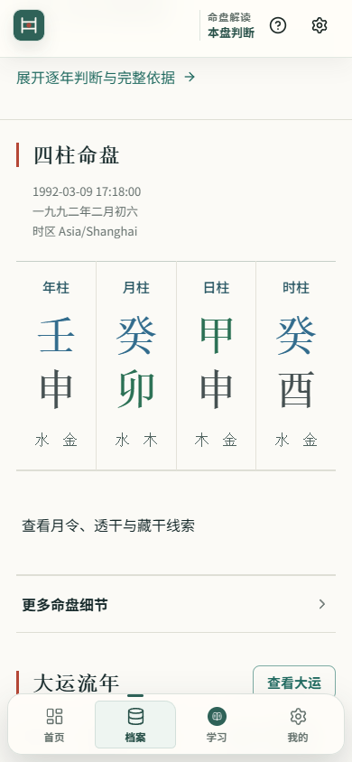
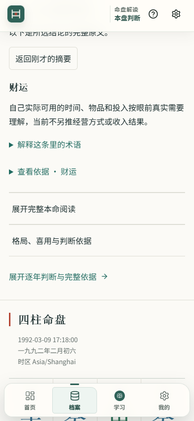

# 手机阅读第一阶段：GitHub 同步范围

2026-10-29。用户要求更新 GitHub 仓库。本次将已交付的六项第一阶段改动、阅读返回修复、摘要来源版本校验及配套验证资料纳入现有候选分支 `codex/event-index-candidate-20261011`，继续通过 [Draft PR #17](https://github.com/TheDeadly-cat/hakimi-suanming/pull/17) 审阅。PR 的基础分支仍为 `codex/journal-event-index-20261010`，不合并或改写 main。

## 用户可见变化

- 手机底部固定首页、档案、学习、我的；档案内可打开保存时的报告原文。
- 白话摘要由现有结论派生，并核对来源版本、规则、修订和范围。未知版本保留原文入口；个人文字不获得自动规则背书。
- 31 个就地术语按完整词匹配；完整结论提供返回原卡片、展开状态与滚动位置的入口。
- 输入页区分城市记录与实际时区，确认原始时间和采用时间；未知时辰/双分支先说明已知、未定及下一步。
- 保存为主要动作，完整导出移入更多菜单；明确保存完整报告范围和精确找回入口。
- “当前阅读范围保存”仅提交 [数据合同设计](../design/current-reading-scope-save-contract-20261029.md)，不启用新的保存格式。

## 身份与验证边界

发布前核对的基底为 `92d9112d8e22f6e27e72831868e24c23f07bf371`。本地固定副本 `b57972ffe0ce` 在提交前由同一批源码构建；报告版本 0.22.3，白话展示版本 0.1.1。副本清单中的“基底加未提交改动”保留为构建时事实，不改写成提交后重建。

源文件核对覆盖已交付的 30 项改动（受保护文件排除），与原验收清单一致。本次额外变更仅为同步说明和复制的验收附件。最终提交身份以此文件所在 Git 提交及 PR head 为准；GitHub Actions 必须按该 head 单独查看。

| 本地证据 | 结果 |
|---|---|
| 第一阶段定向回归 | 16 文件、167 项通过；后续术语专项与复测不累加重复项 |
| 阅读返回/版本绑定接续检查 | 5 文件、51 项通过；随后专题定位工作台 24 项复测通过 |
| 全仓 `npm run typecheck` | program 通过；governance 因 `EXPERT_QUALIFICATION_RECEIPT_LOADER_UNAVAILABLE` 失败，整体退出 1 |
| 默认 `npm run build` | prebuild/program 通过；同一治理原因使整体退出 1 |
| 手机浏览器与固定副本 | 阅读返回位置一致、焦点及展开条件保留；读取旧合成报告后四类原记录一致 |

这里复用已经完成的本地收据，不宣称本次推送时重新运行了测试。历史 Quick CI 的 4357 项属于 `8d57b7d88751df6e2c00bd7de7577527e01269b9` 合并测试组合，不是新提交的 CI。

## 可在仓库直接查看的附件

- [类型检查阶段收据](../review-data/app-reading-stage1-20261029/typecheck-final-receipt.json)
- [默认构建阶段收据](../review-data/app-reading-stage1-20261029/build-final-receipt.json)
- [固定副本阅读返回测量](../review-data/app-reading-stage1-20261029/fixed-reading-return.json)
- [旧合成报告读回记录](../review-data/app-reading-stage1-20261029/fixed-old-report-readback.json)
- [真人任务与观察模板](../review-data/app-reading-stage1-20261029/novice-task-sheet.txt)（待填写，不是结果）

以下截图仅含合成资料。前图为旧固定副本点击完整结论后，正文落在视口上方；后图为 `b57972ffe0ce` 修复后的同类阅读动作。

完整实施范围见 [第一阶段工程记录](app-reading-stage1-20261029.md) 与 [接续审计](app-reading-stage1-audit-20261029.md)。

## 尚未完成

首轮真人任务记录、Android 原生及真机验收、正式专家准入仍未完成；整体改版目标保持 blocked，等待真实记录。GitHub 源码同步不表示专家认可、上架或公开发布，也不改变原日常安装、个人资料、旧试用副本或原失败记录。
