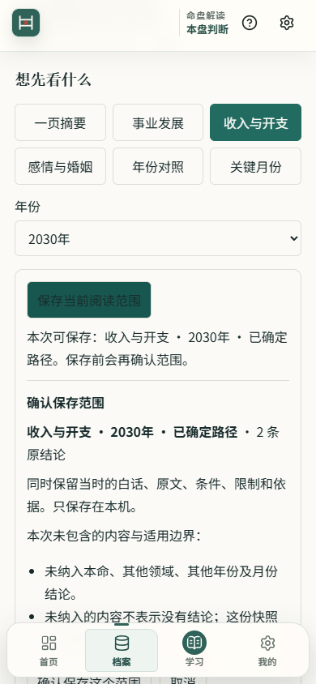
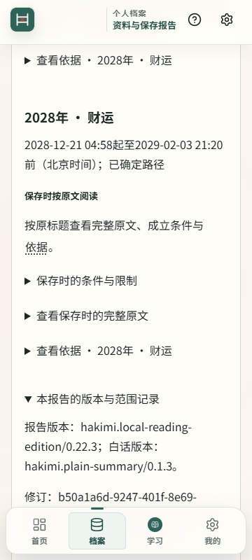
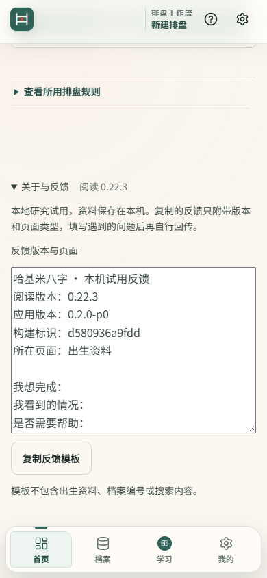

# 手机阅读与 Android 当前状态

2026-10-29 更新。当前本机内部试用入口为 **[5249 新候选](http://127.0.0.1:5249/new)**，构建 **`d580936a9fdd`**，报告 0.22.3、白话 0.1.3。双击 `%USERPROFILE%\HakimiBaziWorkbenchCandidates\scoped-reading-20261029-daf5ff0-d580936a9fdd\origin5249\打开本轮试用.cmd` 可重新启动。它依赖本机现有 Node/Vite，不是通用安装包或 Android APK。

本轮源码在 `codex/event-index-candidate-20261011`，通过 [Draft PR #17](https://github.com/TheDeadly-cat/hakimi-suanming/pull/17) 审阅，基础分支仍为 `codex/journal-event-index-20261010`。独立工程工作继续推进；真人记录、SDK 许可和专家证据分别列为未完成项。

工程结果按提交区分：当前候选源码 `daf5ff0` 的完整 Vitest **4545/4545**、Quick 工程汇总、历史治理 **841/841** 和完整迁移 **45/45** 均已通过；正式专家门槛失败。`110e87f` 的缓存安装失败和 `3d094eb` 的 Chrome 接管失败保留，根因尚未确定。后续说明提交的实时结果见 [PR 检查](https://github.com/TheDeadly-cat/hakimi-suanming/pull/17/checks)，不能套用候选源码的通过结果。

本候选已把学习页无可返回身份时的“到档案看报告／重新选择报告”接到统一报告列表 `/reports`，有可用身份时仍精确返回原修订。新包已实际验证两种返回情况，旧 5248 继续保留原身份。

## 现在可以完成什么

- 在摘要前选择事业、收入、感情、年份或月份；默认概览两张卡，其余原文、条件和依据可展开。2030 年跨专题、跨路由和刷新分别验证，不扩称原生生命周期已完成。
- **保存当前阅读范围**：支持本命概览、单个本命领域、指定年份与明确分支的一个领域、选定的一条月份结论。打开单条月份原文后也能保存该条，无须再用下拉框重选。未知时辰仍保留候选组，不合成唯一范围报告。
- 保存前确认实际范围、分段结论及未包含内容；不会调用全部年份月份准备。取消或准备期间改变年份、专题、修订时零写入；写入后必须读回身份与正文一致才显示成功，结果不明时锁定防止重复写入。
- 新报告保存**当时的白话、原文、条件、限制、来源和版本**。报告列表与个人档案区分完整报告和范围报告；关闭浏览器后可找回同一份。完整保存仍单独存在，按钮明确为“保存完整报告”。
- 新旧混合备份通过真实 ZIP 预检、存储恢复、重开和逐字节比对；同 ID 不同内容、来源错配、未知版本或损坏标记在恢复写入前拒绝。新类型使用已有压缩封装，让旧版日志保持只读，旧完整报告读器明确拒绝不支持的范围子类型。
- “学习”直接浏览和搜索已有 31 个原创词条及短阅读例子，无需先导入文件。专业资料工具保留在二级入口；返回报告前核对本机案例、修订和计算身份。
- 手机“档案”进入已有的按人报告列表，零报告的正式档案也可从人名进入详情，查看资料、修订、最新及历史报告；明确区分“继续当前阅读”和“打开保存时原文”。“全部资料管理”保留时辰待考和回收站入口。

## 固定候选和源码身份

| 项目 | 身份与证据 |
| --- | --- |
| 功能源码 | `daf5ff04cef49f8e38fe9ac31abd291c22250207` |
| CI 实际检出 | PR 合并测试提交 `cc93953996e92acb4d482873a84fec0a0ca34531` |
| 源码树核对 | 两者均为 `1f209001b296e70b786befbbd68ee9422fb37901`，见[构建与检出回执](../review-data/scoped-reading-20261029/fixed-ci-candidate-daf-receipt.json) |
| 构建来源 | [Quick CI 40896529130](https://github.com/TheDeadly-cat/hakimi-suanming/actions/runs/40896529130)，构建与产物合同任务成功；artifact `12907406527` |
| 原下载 ZIP | 4,633,671 字节；SHA-256 `47930c5d102bf2d38de90f784c9f2510bb361924a4def8c10a4ed45066692cfb` |
| 固定产物 | 146 个文件，15,697,381 字节；下载、提取及复制后的资源一致 |
| 数据合同 | `legacy-v13 / schema 13 / migration null`；正式发布证据仍未绑定 |

[固定候选交付回执](../review-data/scoped-reading-20261029/fixed-ci-candidate-daf-receipt.json)记录真实关于版本、学习页两种返回、合成建档、指定年份范围保存、学习返回原修订、个人档案找回、关闭 Edge 后同文重开和窄屏检查。九组检查通过，控制台及页面错误为零。**构建任务成功不等于整个 CI 通过，也不等于专家、权利或公开发布授权。** 后续说明提交不重标固定包的来源，PR head 的 CI 单独报告。

原日常安装身份 `695fb91e98d6 / 0.22.0 / 5202` 保留。本轮没有启动或替换它，也没有导入日常资料。旧 5244、5245、5246、5247、5248 候选及进程保留；`b57972ffe0ce`、`6d56d3d17c02`、`18900d13f8ce` 都是历史副本，不是本轮默认入口。5248 的[原交付回执](../review-data/scoped-reading-20261029/fixed-ci-candidate-9fd-receipt.json)仍保留。新地址使用独立浏览器资料区，旧资料仍留在原地址与原用户配置中。

## 保存、内容和回访证据

- [实际浏览器保存与导出](../review-data/scoped-reading-20261029/browser-scope-save-export.json)：2030 收入保存一份含两条交运分段结论的报告；单月保存一份只含所选条目的报告。两次下载均与解压后的保存封套逐字节一致，个人档案打开正确，关闭重开后文字和记录不变。
- [混合备份恢复](../review-data/scoped-reading-20261029/mixed-backup-receipts.json)：旧普通原文、旧 v1 完整报告和新压缩范围报告共三条，在真实 Schema 13 仓储中恢复后逐字节一致、再次导出摘要相同；冲突和来源错误均零恢复写入。
- 范围保存界面保护 19 项通过；新旧封套、冻结文本和既有压缩读器联合 41 项通过；混合备份六项通过。它们是不同范围的证据，不累计重复复测作为新覆盖，不替代整仓 CI。
- [完整报告容量复测](../review-data/scoped-reading-20261029/full-report-capacity-receipt.json)：Q07 8,256,038 字节、C1 8,267,379 字节保存重开成功；C2 8,454,811 字节超限写前拒绝、零快照写入。没有提高 8 MiB 或索引字符限制、没有截断原文。
- [六类合成内容审阅](../review-data/scoped-reading-20261029/editorial-six-scenarios.json)包含 49 条实际输出。白话 0.1.3 修正 20 条摘要中被遗漏否定角色的条件；精确核对规则与来源版本后才转换，原结论、依据、范围和来源均不变。未知时辰保留 13 候选，没有虚构唯一年份/月报告。真人和专家审阅人数均为零。
- 历史白话 0.1.2 范围记录保留为冻结夹具，新读器读回再编码逐字节相同。保存时文字不重算；后来添加的规则解释明确标为“当前辅助解释/标注”，原限制字句仍可查看。
- [学习入口](../review-data/scoped-reading-20261029/learning-browser-results.json)、[个人档案](../review-data/scoped-reading-20261029/profile-browser-results.json)分别有浏览器路径验证。范围按钮曾存在悬停文字对比不足，原失败保留；[修复复验](../review-data/scoped-reading-20261029/scope-button-contrast.json)为 6.29:1。
- [调整后的档案入口](../review-data/scoped-reading-20261029/archive-entry-browser-result.json)实测 360/390 宽及默认/150% 字体：真实建档后，零报告人名也可进入详情，列表往返、当前阅读、修订、时辰待考及回收站均可找到；原三份合成报告保持一致，点击区至少 44px，无横向溢出或页面错误。对应三个文件 21 项定向测试通过。
- [学习返回与明确分支补验](../review-data/scoped-reading-20261029/learning-fallback-final-receipt.json)：无身份、失效身份均点击到实际报告列表；有效身份精确返回且刷新后保留 2030 年和明确分支。两分支各 36 条月份结论没有串用，列表中立春月与惊蛰月的事业预览各自含不同提要、范围和条件。通过真实表单新增修订后，默认摘要、年份与分支清空，原三份报告和全部旧修订内容不变。修订验证脚本最初遗漏展开折叠控件的失败记录保留，补上真实展开动作后复验通过；学习与报告列表两文件 21 项测试通过。

以上浏览器检查均使用隔离合成资料，没有测试者参与，也没有 Android 真机结果。进程被杀后的未知保存核对和原生文件操作仍待单独验证。

## 工程检查和保留的失败

[本地类型检查](../review-data/scoped-reading-20261029/typecheck-lifecycle-receipt.json)的 program 阶段通过；[默认构建](../review-data/scoped-reading-20261029/build-lifecycle-receipt.json)的 prebuild/program 阶段通过。两条完整 npm 命令仍因正式专家治理失败而整体退出 1。

- `2398506` 的 H1 集成断言修复保留，原计权折叠、当前判断和保存一致性没有放宽。其 4387 项 Vitest 通过；此前 Chrome 迁移前置 `INVENTORY_TIMEOUT` 的历史失败继续保留，不归类为已证明的偶发，也不倒写为通过。
- `1fb610f` 的 v14→v15 Edge 用例在异步 ACK 尚未返回时即时读取。`ff07351` 改为等待真实 ACK，并继续核对已提交状态、构建及发布身份；[本地三场景复验](../review-data/scoped-reading-20261029/migration-ack-local-receipt.json)通过，未改变应用启动预算或重跑旧 GitHub 作业。
- `238bf22` 的原资料管理页增加人名链接，破坏历史 v2 冻结源码身份，导致 CI 命令契约、发布治理、相关 Node 证据工具和迁移前置检查失败。仅调整检出测试不足以修复正式校验。后续恢复原管理页的精确内容，把个人档案入口放到已有按人报告列表；旧 SHA、冻结夹具和正式门槛未改。
- 检出契约另行区分“当前输入字节在 Git 检出后保持一致”与“是否匹配历史 v2 身份”，不把前者冒充后者。[契约修复收据](../review-data/scoped-reading-20261029/ci-checkout-contract-repair.json)记录单文件 28/28、完整五文件 74/74；[冻结校验恢复回执](../review-data/scoped-reading-20261029/frozen-gate-repair-receipt.json)另有四个受影响文件 442 项通过、零跳过，22 个冻结源身份与旧值相同。完整结果仍以该提交自身 CI 为准。
- [238 历史 CI 终态](../review-data/scoped-reading-20261029/historical-ci-238-failure.json)：完整 Vitest 为 375 文件、4542/4542 通过，但整个工程汇总失败；五套迁移都在治理前置阶段失败，浏览器测试未执行。旧失败、产物与 5247 副本保留，不倒写为通过。
- 功能源码 `9fd8571` 的[历史治理](https://github.com/TheDeadly-cat/hakimi-suanming/actions/runs/40808513315)及[五套迁移与完整矩阵](../review-data/scoped-reading-20261029/ci-9fd-migration-success.json)通过，但其 [Quick CI 终态](../review-data/scoped-reading-20261029/historical-ci-9fd-quick-failure.json)仍有单月保存用例失败：4544/4545，未找到成功链接，工程汇总失败。其余 10 项独立工程检查通过；正式专家准入失败独立保留。
- [单月保存阶段诊断](../review-data/scoped-reading-20261029/month-save-phase-diagnosis.json)确认：写入与严格读回后，成功提示还等待当前月份派生刷新；本地一次合成观察的刷新为 16.287 秒，不是真机性能结果。测试改为先证实一次写入与完整读回，再受控发布真实月份结果，最后断言成功链接和完整原月结论；13/13 通过，未修改生产逻辑、提高超时或跳过断言。原 CI 未记录完整保存状态，具体失败原因仍为 UNKNOWN，未重跑或覆盖原失败。
- `3d094eb` 的[Quick 与历史治理终态](../review-data/scoped-reading-20261029/ci-3d-quick-history-terminal.json)：375 文件、4545/4545 Vitest 通过，原单月测试本轮通过；工程汇总通过，历史治理 841/841。正式专家门槛仍失败。
- 同一提交的[迁移终态](../review-data/scoped-reading-20261029/ci-3d-migration-failure.json)为 44/45、零跳过/重试。Chrome 的多旧页面写入冻结用例在 90 秒内未观察到 v16 worker 接替 v13，完整矩阵失败。[原 trace 分析](../review-data/scoped-reading-20261029/ci-3d-chrome-activation-analysis.json)确认切换前两页已 ACK、目标缓存完整；一页最终记录接管已派发，但其派发时刻及后台事件结局未知，不能归因于已证明的偶发、长网络请求或死锁。
- 为该自动接管路径增加有界 CDP、页面状态和透明原生消息 ACK 观察；保留原断言、90 秒时限、旧页面及冻结源码。类型检查和原治理校验通过。[一次本地 Chrome 156.0.8078.49 诊断](../review-data/scoped-reading-20261029/local-chrome-activation-diagnostic.json)在更早的源页启动前置失败，尚未进入新增观察器；与原 CI Chrome 156.0.8078.74 的激活失败分别保留，[前置分析](../review-data/scoped-reading-20261029/local-chrome-bootstrap-analysis.json)不推定未采集的 controller、可见性或焦点状态。
- [最终诊断代码复核](../review-data/scoped-reading-20261029/activation-observer-final-review.json)保留原激活异常，避免附件失败覆盖它；清理仅通过弱引用访问原生端口，保持应用自身的端口与消息处理。`110e87f` 的[远端实际观察](../review-data/scoped-reading-20261029/ci-110-activation-observation.json)已在两浏览器执行：旧源停止并变为 redundant，目标开始 activating，两页 controller_changed；观察结束时尚未记录 CDP activated 事件，完整场景随后通过。此结果不能补齐旧失败缺失的事件。
- `110e87f` 的[Quick 与历史治理](../review-data/scoped-reading-20261029/ci-110-quick-history-terminal.json)分别为 4545/4545 和 841/841，通过工程汇总；正式专家资格门槛仍失败。[完整迁移](../review-data/scoped-reading-20261029/ci-110-migration-failure.json)为 44/45、零跳过/重试。Edge“慢旧页拖过冻结时限后自动重试”场景在 90 秒内未观察到目标缓存；[原 trace](../review-data/scoped-reading-20261029/ci-110-edge-install-failure.json)确认已下载正确目标脚本，随后 `brand-mark.svg` 请求出现 `net::ERR_NO_BUFFER_SPACE`，另 142 个请求取消。安装失败后的缓存清理与观察到的元数据缺失相符；尚未执行八秒慢页注入，底层网络错误原因仍未确定。
- [浏览器身份更正](../review-data/scoped-reading-20261029/browser-version-correction.json)：`3d094eb` 与 `110e87f` 实际均为 Chrome 156.0.8078.74 / Edge 156.0.4314.50。之前的“Chrome 151”来自 trace 用户代理字符串的误读；现按 `browser().version()` 注释更正，原始 CI 产物和外部旧分析保留，不能用浏览器升级解释两轮差异。
- 后续诊断在每个隔离 v13→v16 浏览器进程启动时保留默认脱敏、8 MiB 滚动上限的 `browser-netlog.json`，随既有测试产物保存，用于观察安装前的连接错误。它不重试失败请求、不改变网络特性、断言、超时或冻结应用源码。[本地一次 Edge 定点验证](../review-data/scoped-reading-20261029/netlog-diagnostic-receipt.json)的慢页场景通过，关闭后完整解析 4,820,963 字节、31,723 条事件，未出现 `ERR_NO_BUFFER_SPACE`；完整矩阵门槛正确拒绝单场景结果，命令退出 1。网络日志开关依据 [Chromium 官方说明](https://chromium.googlesource.com/website.git/+/show/HEAD/site/for-testers/providing-network-details/index.md)；这证明诊断实际可用，不证明原 CI 失败已修复。
- `53327f9` 的[Quick 与历史治理](../review-data/scoped-reading-20261029/ci-533-quick-history-terminal.json)为 4545/4545、841/841，工程汇总通过；[完整迁移](../review-data/scoped-reading-20261029/ci-533-migration-success.json)为 45/45，零失败、跳过和重试，五套原场景身份校验通过。26 份新增网络日志全部可完整解析，本次没有 `ERR_NO_BUFFER_SPACE` 或 `os_error=10055`。此轮通过证明该提交的工程结果，不补写历史失败原因；学习返回入口修正不在该提交内。
- 当前固定包源码 `daf5ff0` 的[Quick 与历史治理](../review-data/scoped-reading-20261029/ci-daf-quick-history-terminal.json)为 375 文件、4545/4545 和 841/841，工程汇总通过；[完整迁移](../review-data/scoped-reading-20261029/ci-daf-migration-success.json)为 45/45、零失败、跳过和重试，26 份网络日志完整可解析，未出现同一缓冲区错误。这些结果与当前候选源码对应，正式专家门槛仍失败；后续纯说明提交不改变固定包身份。

固定副本保留 `daf5ff0` 原源码身份。后续说明提交的结果按 [PR 当前提交的检查](https://github.com/TheDeadly-cat/hakimi-suanming/pull/17/checks)逐项核对；完整工程验收须同时核对工程汇总、历史治理和完整迁移矩阵。新运行不能覆盖历史失败，旧 head 的通过也不能替代新 head。

## 完整目标的状态

| 项目 | 当前边界 |
| --- | --- |
| NEXT-01 | 原 H1、ACK 等待及冻结入口修复已落实；当前提交的工程汇总、历史治理和完整迁移矩阵分别见 PR 检查，正式专家准入单列 |
| NEXT-02 / 03 / 07 | 紧凑入口、月份预览、范围保持已实现并分别验证；不扩称 Android 恢复完成 |
| NEXT-04 | 当前固定候选为 5249 / `d580936a9fdd`，明确绑定 CI 检出与同一源码树，README/PR/本入口统一 |
| NEXT-05 | 用户明确尚无五人任务记录，先完成工程交付；真人验收单独待办，不伪造观察 |
| NEXT-06 | 六类合成工程编辑审阅及否定条件修复完成；读者独立复述含义与限制仍待真实记录 |
| NEXT-08 / 09 | Web 当前范围保存、当时白话、列表/档案读回、导出、混合备份预检恢复已组成完整功能；原生进程中断仍待验 |
| NEXT-10 | 内部 Android 工程保留；用户暂不接受 SDK 许可，不下载/安装 SDK，不编译 APK |
| NEXT-11 | 系统返回、软键盘、安全区、大字、文件取消、后台、进程中断、离线和更新保留资料均待真机逐项验证 |
| NEXT-12 / 13 | 初学者学习首页与个人档案详情已实现、完成合成浏览器路径验证 |
| NEXT-14 | 真机保存成本尚未取得，未据此增加 worker 或分块存储平台；本轮沿用既有备份 Worker |
| NEXT-15 | 本文件是唯一人工当前入口；历史记录保留，功能和测试分别提交，不把累计 PR 合入 main |
| NEXT-16 | 原始意见与合格独立专家意见仍为零，正式资格加载器不可用，未伪造认可或更改权利状态 |

[Android 工程边界](../../apps/android/README.md) · [范围保存合同及实现](../design/current-reading-scope-save-contract-20261029.md) · [第一阶段历史记录](app-reading-stage1-github-sync-20261029.md)。源码、固定包、安装、工程 CI、真人任务、专家及公开发布是独立事实。
