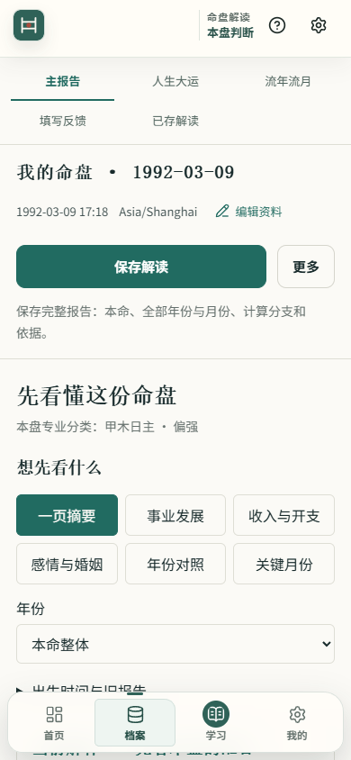
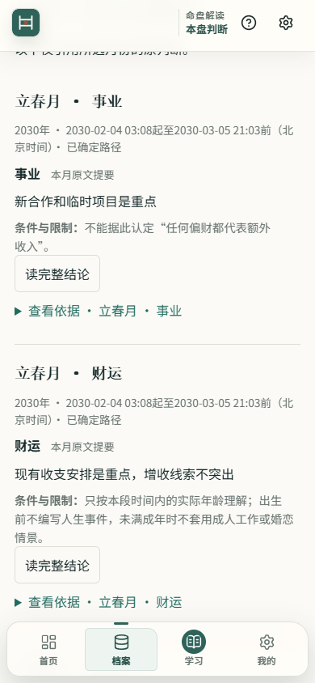

# 手机阅读与 Android 当前状态

更新于 2026-10-29。当前源码候选在 `codex/event-index-candidate-20261011`，通过 [Draft PR #17](https://github.com/TheDeadly-cat/hakimi-suanming/pull/17) 审阅，基础分支仍为 `codex/journal-event-index-20261010`。源码同步不改变日常安装或公开发布状态。缺少真人记录和专家证据仅挂起对应验收项，不阻断独立工程工作。

本轮功能提交分别为 Android 工程 `3bc0092`、手机阅读 `e77035dc15c9af579a69c134950cbe4fb19f24c1`。其后的说明提交仅更新状态、收据和截图；最终 GitHub head 以 PR 为准。

## 本轮用户可见改动

- 摘要前直接显示事业、收入、感情、年份、月份入口和年份选择。默认显示两张摘要卡与简短范围提示，其余结论、条件和依据可以展开。
- 在收入、事业和月份之间切换时保留年份；同标签页刷新或返回报告可恢复选择。临时导航记录只保存选择标识，按案例、修订和报告身份校验。
- 月份列表显示该月的领域、范围、原生产者短提要及关键条件。严格核对来源版本和所属月份；没有兼容来源的内容按原标题和原文阅读。
- Android 内部薄壳、独立依赖锁文件及 Web 产物校验/复制/编译入口已提交。用户明确暂不接受 SDK 许可，本轮保留工程，不安装 SDK。

## 版本与安装边界

报告成稿版本仍为 0.22.3；本轮白话展示版本为 0.1.2。月份提要的来源绑定仅存在当前阅读内存中，不增加保存索引字段或报告字节；重新打开旧保存报告仍按原文读取，不能据此宣称已经实现“保存当时白话”。

日常安装记录仍为 5202 / `695fb91e98d6` / 报告 0.22.0。旧试用固定副本 5245 / `b57972ffe0ce` 保留原身份，属于此前第一阶段，不是本轮提交后重建。当前开发页使用隔离合成资料；本轮新固定候选和 Android APK 均不能由旧副本的验证结果代替。

手机阅读功能提交 `e77035d` 后已完成本地 Web 程序构建，构建身份 `6d56d3d17c02`，产物合同校验通过（`legacy-v13 / schema 13 / migration null`）。这是尚未绑定正式发布证据的本地构建，没有制作固定试用副本、同步为 APK 或替换日常安装。

## 验证与历史失败

本轮本地验证如下；完整 CI 必须读取 PR 当前 head 对应运行，不能套用旧 head。

- 工作台与月份预览最终定向回归 47/47 通过；摘要、保存索引、出生盘来源回归另 32 项通过；容量用例 5 项通过。月份预览的重复复测不重复累加为新覆盖。
- [类型检查收据](../review-data/mobile-reading-next-20261029/typecheck-final-receipt.json)的 program 阶段通过；[构建收据](../review-data/mobile-reading-next-20261029/build-final-receipt.json)的 prebuild/program 阶段通过。两条完整 npm 命令均因正式专家治理阶段失败而整体退出 1，不能写成全绿。
- Edge 合成资料检查覆盖 360/390/430 宽度和 390 宽 200% 根字号：默认两张卡、无横向溢出；390 宽收入入口由 y=2351.875 前移到 y=548.641。年份在摘要之前，大字模式仍需滚动，未声称全部控件首屏可见。
- 实际浏览器验证 2030 收入→事业→月份、刷新、学习页→返回报告；原文返回恢复焦点、展开条件和原滚动位置。双分支保持仅有组件回归覆盖，本次浏览器资料是已确定路径。
- 大字焦点曾被底栏遮住约 5px，[失败记录](../review-data/mobile-reading-next-20261029/after-controls-results.json)保留；修复后年份框底 708.406、底栏顶 750，[最终复验](../review-data/mobile-reading-next-20261029/after-focused-recheck.json)确认无遮挡。该复验也包含最终月份提要和条件，控制台无错误。

| 完整报告容量回归 | 字节数 | 结果 |
| --- | ---: | --- |
| Q07 双分支 | 8,256,038 | 精确恢复此前基线，保存及重开成功 |
| C1 长背景 | 8,267,379 | 保存及重开成功 |
| C2 12,000 字个人原文 | 8,454,811 | 超限，写入前拒绝，快照写入为零，分开全文导出保持完整 |
| C3 换运 | 8,159,592 | 保存及重开成功 |
| C4 第二双分支 | 8,089,872 | 保存及重开成功 |

没有提高 8 MiB/索引字符限制或截断原文；旧记录与旧版读回保留。上述定向测试和容量数字由代理实际执行，依据命令输出整理为 [验证摘要](../review-data/mobile-reading-next-20261029/agent-validation-summary.json)；摘要不是原始日志，未另存的命令输出不冒称已有日志文件。

以下截图均为合成资料，属于本轮 Web 检查，不是 Android 真机验收。

已推送的测试修复 `2398506967e2eff43ce4d7c2b28e6868811cab2e` 保留原计权折叠、当前判断和保存一致性断言，将专业分类断言从 H1 移至明确的专业分类区域；本地该文件 7 项通过。

该修复提交的 [Quick CI 40795836680](https://github.com/TheDeadly-cat/hakimi-suanming/actions/runs/40795836680) 工程汇总通过，完整 Vitest 为 366 文件、4387/4387；正式汇总仍失败。[按 head 记录的观察收据](../review-data/mobile-reading-next-20261029/ci-2398506-observation.json)保留具体状态与部分日志来源。这些结果只属于 `2398506`，不替代其后 UI/Android 提交的检查。

该提交的 [Migration CI 40795836722](https://github.com/TheDeadly-cat/hakimi-suanming/actions/runs/40795836722) 出现真实工程失败：`cross-schema-v13-v15` 的 Chrome 新页启动用例未进入 ready，此套件 5/6 通过。[诊断附件](https://github.com/TheDeadly-cat/hakimi-suanming/actions/runs/40795836722/artifacts/12863414609) 记录 `INVENTORY_TIMEOUT`：启动前的 `indexedDB.databases()` 在 5 秒内未完成，进入 `preboot recovery ambiguous`，正常阅读界面尚未加载。实际合并测试提交为 `68b79ac12007`，请求 head 为上述 `2398506`。没有据此认定是偶发、资料损坏或旧 Service Worker 接管；根因仍待受控复现。该失败保留，未重跑，不能描述为只有专家门槛失败。正式专家准入另因 `EXPERT_QUALIFICATION_RECEIPT_LOADER_UNAVAILABLE` 失败。

Android 仅确认源文件语法、独立依赖、旧 Web 产物身份校验与复制一致性。Gradle 配置在 Windows 中文路径上被 AGP 拒绝；SDK 未安装，APK 编译与设备测试均未完成。详见 [Android 工程说明](../../apps/android/README.md)。

## 完整接续范围

| 项目 | 当前边界 |
| --- | --- |
| NEXT-01 | H1 断言修复已推送；当前候选全工程 CI 仍需按自身 head 验证，迁移失败仍待定位 |
| NEXT-02 / 03 / 07 | 紧凑入口、月份预览和导航保持已实现；浏览器与组件验证分别记录 |
| NEXT-04 | 功能提交后已构建 `6d56d3d17c02`，新固定试用副本尚待制作；旧固定包不改名、不重标来源 |
| NEXT-05 | 五人真实任务结果待返回，不伪造参与者或完成记录 |
| NEXT-06 | 六类合成场景的白话内容审阅尚未完整交付 |
| NEXT-08 / 09 | 当前范围保存与保存当时白话仍只有合同设计；尚未实现新的写入、列表、读回和混合备份闭环 |
| NEXT-10 | Android 内部工程已提交；用户暂不接受 SDK 许可，APK 暂不编译 |
| NEXT-11 | 原生返回、键盘、安全区、大字、文件取消、后台、保存中断、离线、更新保留资料均待真机逐项验证 |
| NEXT-12 | 现有 31 个就地术语保留；学习落地页尚未完成 |
| NEXT-13 | 现有保存报告入口保留；按人分组的档案详情尚未完成 |
| NEXT-14 | 真机保存成本尚未测量；未以此推动 worker 或分块存储改造 |
| NEXT-15 | README 和 PR 指向本入口；UI、Android、状态说明分开提交供审阅，保留历史记录 |
| NEXT-16 | 原始合格独立专家意见仍为零，未推导或伪造专家认可 |

历史第一阶段证据见 [首次同步记录](app-reading-stage1-github-sync-20261029.md)、[阅读返回审计](app-reading-stage1-audit-20261029.md)；范围保存约束见 [数据合同设计](../design/current-reading-scope-save-contract-20261029.md)。这些历史资料不替代本轮验收。
